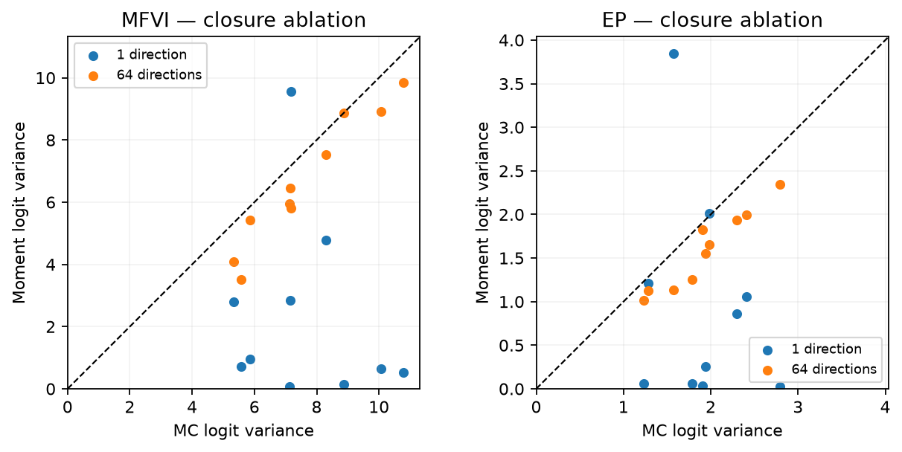
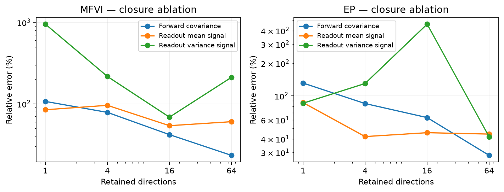
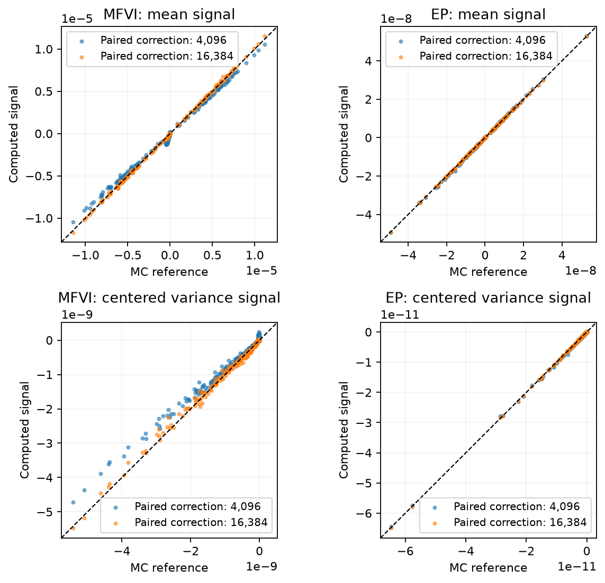

# Sampling-assisted moment propagation: evidence and ablations

The R/TensorFlow, PyTorch and JAX implementations agree on the same learned
ResNet-20 beliefs. The remaining discrepancies against complete-network
Monte Carlo reveal which mathematical approximations need more attention.

This comparison fixes the saved mean/variance beliefs, normalization statistics,
CIFAR-10 test input 0 (label 3), and nested Rademacher directions (seed 6200).
The MFVI and EP checkpoints remain separate beliefs. No training or checkpoint
selection uses this diagnostic input. The comparison is a local fidelity study,
not evidence of a change in test accuracy or a universal ranking of methods.

The main accuracy refinement in this section is **sampling-assisted moment
propagation**: integrate a frozen Gaussian surrogate, then use paired network
draws to estimate its nonlinear remainder. The weight belief stays one Gaussian.
The correction is stochastic; it is not the uncorrected 64-direction closure.

Read the residual identity and native implementation first, then the corrected
messages against Monte Carlo. The retained-direction plots are **ablations**:
they explain why covariance retention alone is insufficient. The exact Gaussian,
EP and MFVI message-equivalence checks in Section 2 retain their separate role.

### What the R/TensorFlow repair established

The earlier R/TensorFlow experiment applied this residual correction to 236
selected parameter coordinates spanning the ResNet-20 blocks. On the first of
four predeclared CIFAR-10 inputs, 2,048 correction evaluations were compared with
an independent 8,192-network reference. Relative errors were:

| Method | Mean signal: baseline → corrected ↓ | Raw-second signal: baseline → corrected ↓ |
|---|---:|---:|
| MFVI | 68.30% → 4.64% | 68.09% → 4.34% |
| EP | 50.29% → 9.09% | 52.13% → 9.14% |

Mean and raw-second errors decreased on all four inputs. This is the successful
sampling-assisted repair; it is not evidence that a 64-direction closure alone
is accurate. The raw-second signal is $d_s=2m\odot d_m+c$, whereas the centered
variance signal is $c=2v^2\odot g_v$. A large mean contribution can hide errors
in $c$. In this earlier experiment the corrected centered-signal error was about
133% for both methods, with very large MC uncertainty. The readout experiment
below therefore checks mean and centered variance separately with a larger,
independent reference. The two studies have different coordinates and references;
their percentages are not a common learning curve.

The source CSV, including every input and its MC standard error, is
`r_residual_confirmation.csv` in the supplied matched evidence. These are recorded
R/TensorFlow results, not newly executed full-network experiments in every backend.

## Implementation agreement

There are **80 passing comparisons**: two beliefs, four covariance ranks,
five quantities, and R/TensorFlow and JAX each compared with PyTorch. Quantities
are output mean, full output covariance, objective, and all weight mean and
variance derivatives. The maximum absolute discrepancy is **1.82e-13** in
float64. Source and checkpoint hashes are in `learned_cross_backend.json`.

Consequently, no framework has a meaningful approximation advantage in this
matched calculation. A backend should not receive credit for using a different
belief, rank, quadrature, or objective. The separate readout-derivative check
also agrees to **2.23e-16** across all three implementations.

## Closure ablation: why retaining directions is insufficient

The independent reference uses **524,288 complete networks per belief**, in
8,192 independent groups of 32 antithetic pairs. Its relative standard errors
are computed from groups, rather than treating paired draws as independent.
The output-variance reference has about 0.25% relative standard error. For
mean/variance messages the corresponding values are 0.88%/0.75% for MFVI and
2.31%/1.39% for EP. These are norm-based standard-error summaries, not
simultaneous confidence intervals for every coordinate.

| Approximation | MFVI output covariance error ↓ | EP output covariance error ↓ |
|---|---:|---:|
| Independent activation variances | 99.0% | 98.0% |
| 4 shared directions | 78.5% | 84.9% |
| 16 shared directions | 41.8% | 63.0% |
| 64 shared directions | 23.3% | 28.2% |

Retaining correlations helps substantially here. It does not make the nonlinear
activation closure exact. Moreover, a better forward covariance does not by
itself guarantee a better backward variance signal: the small classification
head still approximates a nonlinear Gaussian integral.

**Separating head integration from hidden-layer approximation.** Hold the
64-direction hidden representation fixed and refine only its nine-dimensional
Gaussian classification integral. This requires no further complete-network
evaluations. The same high-precision reference gives:

| Head rule | MFVI mean / variance error ↓ | EP mean / variance error ↓ |
|---|---:|---:|
| 18-node rule | 60.3% / 211.5% | 44.4% / 41.8% |
| 262,144 antithetic Sobol nodes | 49.2% / 38.8% | 42.7% / 31.6% |

The MFVI variance-message discrepancy falls substantially even before nonlinear
residual correction. The remaining error motivates that correction: accurate
integration of an approximate hidden distribution does not make it the true
hidden distribution. This is a shared PyTorch numerical ablation, not an
additional training result for each framework.

## A less noisy readout variance calculation

Consider an independent Gaussian readout weight, conditional on a hidden vector
$h$: $z_j=\sum_i W_{ji}h_i+b_j$. The hidden vector need not be Gaussian. For a
smooth scalar function $F$, differentiation of a Gaussian density gives
$\partial_m q=-\partial_w q$ and $\partial_vq=\tfrac12\partial_w^2q$.
Integration by parts, with vanishing Gaussian boundary terms, therefore gives

$$\partial_{m_{ji}}E[F]=E[h_i\partial_{z_j}F],\qquad
\partial_{v_{ji}}E[F]=\tfrac12E[h_i^2\partial_{z_j}^2F].$$

Conditioning on $h$ proves these identities for the affine readout; averaging
over its independent upstream weights completes the proof. This argument does
not apply unchanged when the readout and upstream weights are correlated.

Write $p=\operatorname{softmax}(z)$, $r_j=1_{j=y}-p_j$, and
$H_{jj}=-p_j(1-p_j)$. MFVI uses $F=\log p_y$, whose derivatives are $r_j$
and $H_{jj}$. EP uses $F=p_y$, whose derivatives are $p_y r_j$ and
$p_y(H_{jj}+r_j^2)$. EP averages these **unnormalized** derivatives and $p_y$
before dividing by $Z=E[p_y]$. Averaging per-network log-probability derivatives
would instead compute the MFVI objective.

The corresponding mean and centered-second moment signals are
$d_m=v\odot g_m$ and $d_s-2m\odot d_m=2v^2\odot g_v$.
We compare the centered signal explicitly: a large $2m\odot d_m$ term can
otherwise obscure variance-derivative error. These are directions, not posterior
variances; EP and MFVI use their own finite-update rules afterward.

The implementation is `sampled_readout_adjoint` in `tensorflow/R/inference.R`,
`pytorch/src/bayesify_torch/heads.py`, and `jax/src/bayesify_jax/heads.py`.
Independent direct-Hessian and Gaussian-quadrature tests check the derivatives,
in addition to the cross-framework numerical comparison.

## Paired nonlinear correction

Let $F_0$ be a frozen linear-logit surrogate. For an integration proposal $r$
covering $q$, the identity
$E_q[F]=E_q[F_0]+E_r[(q/r)(F-F_0)]$ follows by linearity and change of measure.
Apply the same identity to the readout derivatives above, using the **same**
network perturbation for each nonlinear/surrogate pair. This preserves their
correlation and reduces avoidable subtraction noise. The surrogate, proposal,
and integration weights are held fixed during this derivative calculation.
For EP, correct $Z$, $\partial_mZ$, and $\partial_vZ$ before division. A finite
ratio estimate has finite-sample bias; this identity does not make it an exact
finite-sample tilted update.

The integration proposal here is a bounded two-component proposal in standardized
Gaussian coordinates. The represented network belief remains **one Gaussian**.
No mixture is fitted as a replacement posterior.

| Readout approximation | MFVI mean error ↓ | MFVI variance error ↓ | EP mean error ↓ | EP variance error ↓ |
|---|---:|---:|---:|---:|
| 64-direction closure, original head | 60.3% | 211.5% | 44.4% | 41.8% |
| Paired correction, 4,096 evaluations | 10.1% | 17.2% | 2.73% | 2.09% |
| Paired correction, 16,384 evaluations | 2.79% | 5.85% | 0.98% | 0.97% |
| Paired correction, 65,536 evaluations | 1.45% | 2.92% | 1.29% | 0.70% |

Errors near the reference standard error should not be over-ranked. For example,
the final two EP rows do not establish that 16,384 evaluations are intrinsically
better than 65,536. These rows test the readout block only; the ordinary
cross-framework check above tests derivatives of every weight block.

| Correction evaluations | MFVI total seconds ↓ | EP total seconds ↓ |
|---|---:|---:|
| 256 | 2.01 | 0.30 |
| 4,096 | 3.75 | 2.06 |
| 16,384 | 9.34 | 7.69 |
| 65,536 | 31.80 | 30.15 |

These NVIDIA L4 measurements include Jacobian/surrogate preparation and the
readout correction; MFVI ran first and paid more first-use overhead. They are
one-input diagnostic timings, not training or serving-time claims. The
524,288-network references took 189/195 seconds in float32 with float64
statistics; corrections used float64. The ordinary closure also computed all
weight derivatives, whereas the correction returned readout derivatives only.
Those different work/dtype boundaries prevent a fair general speedup claim.

The main refinement is the paired nonlinear residual. The uncorrected
64-direction closure is retained as an ablation, not an accurate backward
replacement. The earlier R/TensorFlow study and the later readout study have
different validation scopes; native small-fixture agreement does not establish
all-layer corrected training equivalence across the three frameworks.

## Reproduce the comparison

Run `python site/compare_approximations.py` from the repository root to rebuild
the error CSV and all three figures from the supplied arrays. They contain
moments and messages, not checkpoint weights or training data. Each native
backend's arrays are retained separately. The correction and MC reference were
computed in PyTorch; they are explicitly shared references, not additional
R/TensorFlow or JAX training runs.

The full-network reference can be regenerated with
`pytorch/learned_fidelity.py --checkpoint ... --method mfvi --batches 8192`.
`pytorch/head_ablation.py --work ...` changes only the Gaussian head rule;
`pytorch/readout_correction.py --work ...` computes the paired nonlinear
readout correction. Both diagnostics expect the checkpoint and fixed input
layout documented in their command help. Checkpoints remain outside this
supplement; the supplied arrays suffice to reconstruct all displayed figures.
